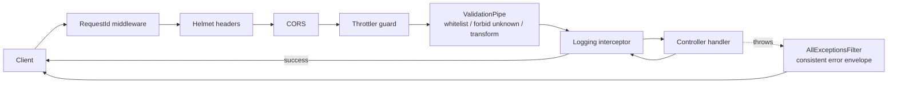
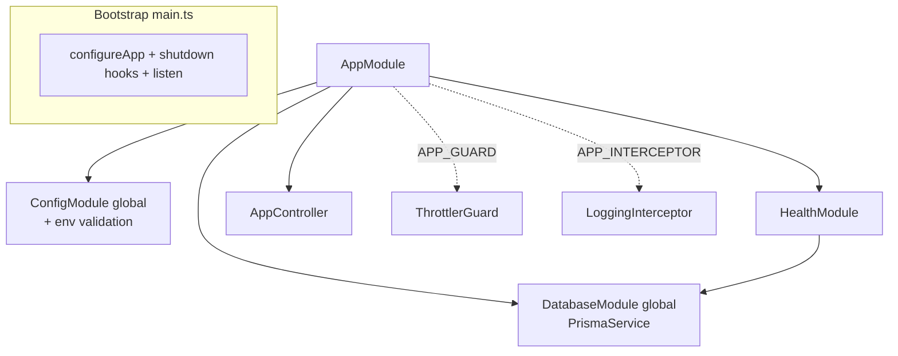
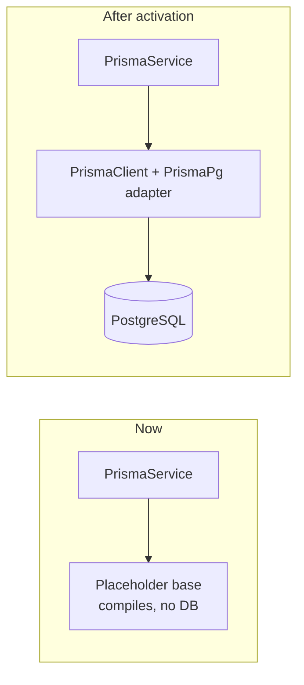
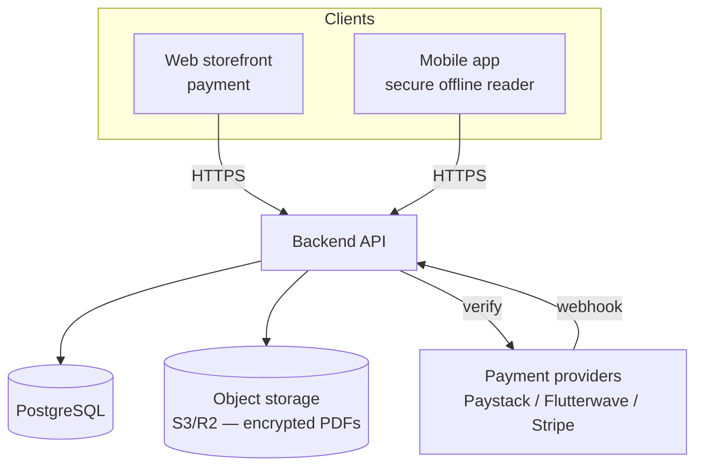
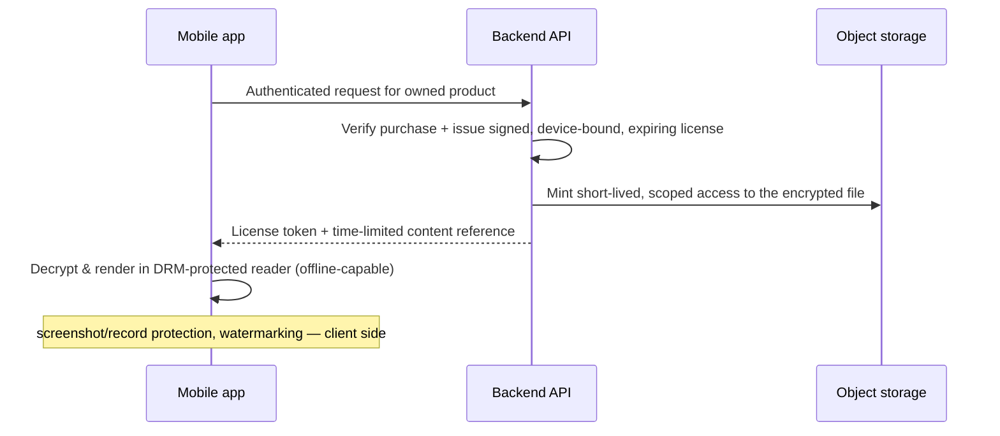

# Architecture

This document describes the **current** backend foundation and the **planned**
architecture it is designed to grow into. It is a living document: the "planned"
sections are intentions, not shipped features.

---

## 1. Purpose & principles

The backend serves a secure academic past-questions platform. Payment happens on
the web; the mobile app is a secure offline reader; the backend is the source of
truth for accounts, entitlements, content metadata, and license issuance.

Foundation principles:

1. **Secure by default.** Validation, security headers, rate limiting, and
   leak-free error handling are global — every future endpoint inherits them.
2. **Single source of truth for config.** All configuration flows through
   validated, typed `@nestjs/config`; no scattered `process.env` reads.
3. **Fail fast.** Invalid environment configuration stops the process at boot
   with a clear message, not at a random later point.
4. **No premature business logic.** The foundation is deliberately thin so the
   domain can be designed deliberately in later phases.
5. **Buildable on a fresh clone.** The database client is consumed behind a seam
   so `git clone && npm install && npm run build` succeeds with no database.

---

## 2. Current foundation

### 2.1 Request pipeline

Every request passes through the same cross-cutting layers before (and after) it
reaches a controller:



- **RequestId middleware** — honours an inbound `X-Request-Id` or generates a
  UUID; correlates logs and is echoed back on the response.
- **Helmet / CORS** — HTTP hardening; CORS origins come from config.
- **Throttler guard** — fixed-window rate limiting; shared through PostgreSQL in production, in-memory in development (see `src/common/guards/`).
- **ValidationPipe** — rejects unknown fields, coerces/validates DTOs.
- **Logging interceptor** — one structured line per request (see §2.5).
- **AllExceptionsFilter** — maps any thrown error to the standard envelope.

### 2.2 Module composition



- `ConfigModule` and `DatabaseModule` are **global** — config and the single
  `PrismaService` are injectable everywhere without re-importing.
- The **global exception filter** is registered in `main.ts`/`configureApp`
  (it needs the resolved production flag), not as an `APP_FILTER` provider.
- `configureApp` (`src/common/configure-app.ts`) applies the shared HTTP config
  and is used by **both** `main.ts` and the e2e suite, so tests exercise the
  real pipeline.

### 2.3 Configuration & validation

`src/config/env.validation.ts` declares an `EnvironmentVariables` class with
`class-validator` constraints and validates `process.env` at boot.
`src/config/configuration.ts` maps the validated values into a typed
`Configuration` object (`app`, `database`, `throttle` namespaces) read via
`ConfigService`.

### 2.4 Database integration seam

Prisma 7 uses the `prisma-client` generator (a generated client under
`src/generated/prisma/`) plus a driver adapter (`@prisma/adapter-pg` + `pg`).
Those artifacts do not exist on a fresh clone. Rather than let that break the
build, all code imports from one seam:

```
src/database/prisma-client.ts   ← the ONLY file that knows the client shape
        ↑
src/database/prisma.service.ts  ← extends the seam's base class
        ↑
feature modules                 ← inject PrismaService
```

In placeholder mode the seam exports a minimal base class so the app compiles
and boots (DB calls throw a clear "not generated" error, and `PrismaService`
logs a warning and continues instead of crashing). Activating the real client is
a localized change documented in the file header and the README.



### 2.5 Logging policy (security-critical)

The logging interceptor emits one structured line per request containing:
**request id, method, route, status, response time**.

It **never** logs: request/response bodies, headers, query strings, passwords,
access/refresh tokens, raw license tokens, private document URLs, or secrets.
Known sensitive keys are redacted defensively. The exception filter logs 5xx
errors with stack traces **server-side only**; clients receive a generic
message in production. **This policy must be preserved as features are added.**

### 2.6 Health checks

- `GET /api/v1/health` — liveness; returns `{ status: "ok", uptime, timestamp }`
  without touching the database.
- `GET /api/v1/health/db` — readiness; probes PostgreSQL and **degrades**
  (`status: "error"`) instead of throwing, so a DB outage is a clear signal
  rather than an unhandled 500.

---

## 3. Planned architecture (not yet implemented)

The foundation is shaped to receive the following. None of it exists yet.

### 3.1 System context



### 3.2 Planned domain entities

Introduced incrementally in later phases (with migrations):

- **User / Auth** — accounts, hashed credentials, JWT access + refresh tokens.
- **Product** — a purchasable past-question item and its metadata.
- **Purchase** — a completed, provider-verified transaction granting access.
- **License** — a signed entitlement binding a user + product + device, with
  expiry, enabling offline reading.
- **Device** — registered devices for license binding and revocation.

### 3.3 Planned secure-content flow



Security intents for that phase: encrypt PDFs at rest, never expose durable
public URLs, bind licenses to device + expiry, verify payments server-side
(never trust the client), and keep all tokens/secrets out of logs.

---

## 4. Notable decisions & trade-offs

| Decision | Rationale | Upgrade path |
| --- | --- | --- |
| Hand-rolled rate-limit guard | `@nestjs/throttler` not a dependency; keep the foundation self-contained | Swap for `@nestjs/throttler` + a shared store (Redis) before scaling horizontally |
| Hand-rolled health checks | `@nestjs/terminus` not a dependency | Adopt Terminus later without changing routes |
| Prisma client behind a seam | Keep a fresh clone buildable with no DB/generated client | One-file activation (see §2.4) |
| Built-in Nest `Logger` instead of `@nestjs/observe` | Avoid a paid SaaS dependency and placeholder credentials in the foundation | Add an observability backend later if desired |
| Global filter in `main.ts`, not `APP_FILTER` | It needs the resolved `isProduction` flag | — |

---

## 5. Conventions

- **ESM + `nodenext`**: relative imports use explicit `.js` extensions.
- Read config via `ConfigService`, never `process.env` in feature code.
- New env vars: add to `env.validation.ts`, `configuration.ts`, and
  `.env.example` together.
- Preserve the logging policy (§2.5) and the leak-free error envelope in every
  new module.
